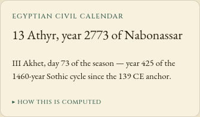
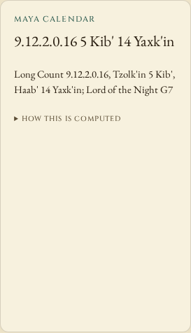

# Egyptian season coordinates and Maya night-cycle anchors

Baseline `7166a0b` assigns the season number to an Egyptian month and calls its
day of the month a day of the season. Athyr 13 therefore reads `Akhet I, day 13
of the season`. The actual coordinates are **III Akhet, day 73 of the season**.
Months I-IV restart within each of Akhet, Peret and Shemu; four 30-day months
give each season 120 days. The five epagomenal days remain outside the seasons.

The Maya library is one position ahead in its nine-day G cycle. It returns G8
for the interpreted Piedras Negras inscription `9.12.2.0.16`, documented as G7,
and G1 at period endings where the reference gives G9. Both public functions
now use that anchor. The Maya tablet also includes the computed G label.

| Example | Baseline | Corrected |
| --- | --- | --- |
| Egyptian Athyr 13 | Akhet I, season day 13 | III Akhet, season day 73 |
| Egyptian Pharmuthi 13 | Peret II, season day 13 | IV Peret, season day 103 |
| Egyptian Mesore 30 | Shemu III, season day 30 | IV Shemu, season day 120 |
| Maya `9.12.2.0.16` | G8 | G7 |
| Maya 2 January 2004 | G1 | G9 |
| Maya `13.0.0.0.0` period ending | G1 | G9 |

## Reference evidence

[UCL's Digital Egypt month table](https://www.ucl.ac.uk/museums-static/digitalegypt/chronology/calendar.html)
provides twelve month coordinates. Its modern-date column describes the
Alexandrian/Coptic calendar; those dates and its leap rule are **not** copied
into the wandering Nabonassar calculation.

Mark Pitts's [*Maya Numbers & the Maya Calendar*, Book 2](https://www.famsi.org/research/pitts/MayaGlyphsBook2.pdf)
provides the G9 period-ending rule on printed page 88, the interpreted inscription
on page 92, and a dated table on page 99. The original pages were visually
inspected. [`reference.json`](reference.json) retains ten factual numeric/date
records, source URLs and the downloaded PDF's SHA-256. The PDF is not vendored.
The earlier claim that G1 at creation was a widely used alternative has been
removed; it did not justify disagreement with these anchors.

## Reproduction

```sh
npm ci --ignore-scripts && npm run build:lib
node studies/calendar-coordinates/replay.mjs --library dist/lib/index.js \
  --out /tmp/calendar-coordinates.json --label source
```

For the baseline, extract `git archive 7166a0b`, build its library, and pass that
`dist/lib/index.js` to the same replay with `--observe-only`. No browser, date
service or unpinned calendar dependency supplies the expectations.

| Study group | Cases | Baseline disagreements | Corrected disagreements |
| --- | ---: | ---: | ---: |
| Every ordinary day in an Egyptian year | 360 | 330 | 0 |
| Five epagomenal days | 5 | 0 | 0 |
| Modern and pre-era Egyptian controls | 5 | 5 | 0 |
| Published Maya table/inscription dates | 10 | 10 | 0 |
| Constructed Maya cycles and period endings, two correlations | 62 | 62 | 0 |
| Total | 442 | 407 | 0 |

The [before](results/before.json) and [after](results/after.json) captures
include observations, expectations and compiled-module hashes. Egyptian
comparisons parse the ordinal, season and day independently of their display
order, so moving the Roman numeral before the season does not itself count as
a correction. Day positions are enumerated through the published month table.
The ten Maya dates are literal published lookups; the other 62 cases are
arithmetic controls, including backward cycles and the caller-selected 584285
correlation. They are not additional observed inscriptions or an accuracy sample.

Egyptian year/month/day, native labels, Sothic arithmetic and proleptic flags
remain unchanged. Maya Long Count, Tzolk'in and Haab' controls remain unchanged.
The study does not revalidate the Nabonassar epoch, Sirius observations, ancient
day-boundary practice, alternative correlations, or identities of night deities.

## Installed library and clock page

Code commit `14ce652` was extracted with `git archive` into a fresh directory.
The locked install passed lint, strict types, 249 unit tests, the library/site
build, the runnable basic-usage example and 58 Chromium/Firefox browser tests.
Checks ran on Node 24.21.0; a Node 26.7.0 build produces exactly the same 57
library files and 30 site files. All 102 tracked source, test and build inputs
match the tested archive.

The packed `@antonsoloviev/horologium` 0.2.3 artifact is 75,308 bytes with SHA-256
`8e5624036ca4db62a09548c34865fe182550772fc98945e0a59dd27ae7f28626`.
Separate installs pass all 442 cases on [Node 24](results/installed-node24.json)
and [Node 26](results/installed-node26.json). All 38 shipped library JavaScript
and declaration files match both installations and the tested clean build.
An installed consumer imports the package by its exported name and obtains
the same G7 inscription and corrected season positions. The version was not
published to npm; this is verification of the locally packed source artifact.

[`browser.mjs`](browser.mjs) changes actual clock dates and opens explanations
while disconnected, in Chromium and Firefox at 1440 and 375 pixels. The
[before](results/browser-before/browser.json) and
[after](results/browser-after/browser.json) captures retain 48 total date and
explanation workflows. Each phase checks all 30 served files against its
build and verifies the 29 files actually loaded by each browser context.
Offline interactions make no requests and preserve the existing tablet DOM
nodes. Native date labels and Sothic text match between phases. The ten
screenshots were visually inspected; the added G label wraps within the
existing mobile card without page overflow.

```sh
node studies/calendar-coordinates/browser.mjs --source . --phase after \
  --out /tmp/coordinate-browser --shots /tmp/coordinate-shots
```

The [verification receipt](results/verification.json) retains artifact, source,
build, runtime and local check-log hashes. Browser startup loads the bundled
fonts before disconnection. This checks the current UTC-based calendar model;
it does not establish historical sunset boundaries or additional epigraphic
claims. No hosted deployment, registry release or remote CI result is claimed.




