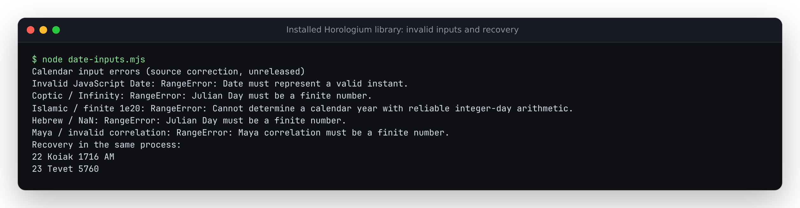

# Invalid dates must not hang calendar calculations

The installed library at source baseline `0452cda` can block a Node process:
`coptic.copticFromJD(Infinity)` and `islamic.fromJD(1e20)` never finish. At large
finite magnitudes, incrementing an estimated year by one stops changing the
floating-point number. The inverse's unbounded correction loop keeps running.

Invalid JavaScript Dates are another failure path. `core.dateToJD(new Date('invalid'))`
returns NaN; `hebrew.fromJD` then falls through to an assumed last day of Elul,
with an invalid year. Other calendars select default names or G labels alongside
NaN fields. An unknown date does not establish those calendar coordinates.

| Input | Baseline observation | Corrected result |
|---|---|---|
| Coptic/Ethiopian/Islamic infinities | Calculation exceeds process deadline | RangeError |
| Coptic/Ethiopian/Islamic/Hebrew finite `1e20` | Calculation exceeds process deadline | RangeError |
| Invalid JavaScript Date | NaN Julian day | RangeError at the Date bridge |
| Hebrew NaN Julian day | Month 6, day 29, invalid year | RangeError |
| Unsupported JavaScript Date instant | Invalid Date object | RangeError |
| Valid historical and modern controls | Calendar coordinates | Identical coordinates |

## Implementation boundary

Inverse calendar entry points reject non-finite Julian days. Shared year
bracketing for Coptic, Ethiopian, Islamic and Hebrew conversion permits at most
eight corrections and checks safe year increments, representable midnight
boundaries and allowed year lengths. Failure to establish a year raises an error
instead of looping or selecting a fallback day. Hebrew molad month/part counts
must remain exact safe integers, including intermediate arithmetic.

Maya, Egyptian and Zoroastrian elapsed day counts must fit safe integers. Civil
conversion rejects unrepresentable year/month/day fields. Maya correlation
parameters must be finite. Date bridges reject invalid Date objects and instants
outside the native JavaScript Date range. Arithmetic calendars retain their own
precision boundaries; they are not all limited to the clock editor or Chinese
calendar's Gregorian -5000 through 5000 range.

These checks establish input and arithmetic boundaries, not ephemeris accuracy
or historical attestation of distant projections. Forward date-field arithmetic
has not become a complete validator for every supplied month/day tuple.
The later [forward-date correction](../forward-dates/README.md) adds month/day
validation while retaining valid fractional-day arithmetic.

## Real process replay

```sh
npm ci --ignore-scripts && npm run build:lib
node studies/date-inputs/replay.mjs --library dist/lib/index.js \
  --out /tmp/date-inputs.json --label source
node examples/date-inputs.mjs
```

[`replay.mjs`](replay.mjs) invokes the actual library in a separate Node process
for each malformed case. A `READY` marker precedes the calculation, distinguishing
calculation hangs from import/startup failures. The parent enforces a 1.2-second
deadline, captures unedited stdout/stderr, and requires a valid Coptic conversion
after each refusal in the same process. Timeout children are terminated; none
remain running. Inputs are deliberately constructed, not production incidents.

The [baseline](results/before.json) has 78 contract disagreements across 90
malformed cases, including 18 calculation timeouts. Twelve existing refusals in
the Chinese/Greek/Babylonian paths remain refusals. The
[corrected capture](results/after.json) has zero disagreements or timeouts,
and all 90 processes recover. The 843 converter outputs over 45 valid dates
match exactly between phases, including BCE, era boundaries, leap-year and
wider arithmetic controls. Native JavaScript Date provides a separate UTC
bridge check on 42 dates; preserving the remaining calendar outputs is a
regression check, not an independent historical accuracy oracle.

To replay the baseline, pass the library built from `git archive 0452cda` to
the same driver with `--observe-only`. Module hashes and the valid-output digest
identify each capture. The source tests also isolate formerly unbounded
conversions in disposable child processes, so a regression cannot lock the test
runner's main thread.

## Clean builds and installed package

Code `2aac6bc` was exported with `git archive` and installed from the lockfile
on Node 24.21.0. Lint, strict types, 256 tests in the default locale and 256 in
the configured German locale, both runnable examples, the package/site build
and 58 production Chromium/Firefox workflows pass. Node 26.7.0 produces the
same 60 library files and 30 site files. The receipt identifies 104 selected
tracked source, test and build inputs that match the clean archive.

Separate [Node 24](results/installed-node24.json) and
[Node 26](results/installed-node26.json) installations each run all 90 malformed
requests in real child processes, reject them before the deadline and recover
with a valid date in the same process. Both reproduce all 843 baseline valid
outputs. The public package export also runs the demonstration script directly;
its output is identical between the two versions.

The local 0.2.3 tarball is 76,595 bytes, SHA-256
`79dfc8311fcbb610641a148d2a2598cb16acc98d160d6d0089b2b4049e4cc529`.
All 40 shipped JavaScript/declaration files match the clean build and both
installations. [`verification.json`](results/verification.json) retains the
artifact, source, build, runtime and local check-log hashes. The tarball is not
an npm release; no registry version, tag or hosted deployment is claimed.

The existing clock replay also verifies 24 offline date/explanation workflows
in both engines at 1440 and 375px. All 30 served files match the clean build,
and the 29 files actually loaded by each browser match those hashes. The clock
already limits user dates; this library correction preserves its displayed
coordinates. Six actual browser screenshots and the installed terminal image
were visually inspected. The [browser receipt](results/browser/browser.json)
records the checks. The [terminal capture](../../docs/assets/date-inputs.ansi)
is unedited stdout from `node date-inputs.mjs` in the installed consumer.


