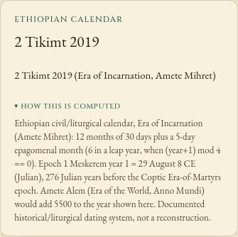

# Which Ethiopian era is being displayed?

The calculation returned the right date, but its explanation named the wrong
era. On Gregorian 12 October 2026, the tablet showed `2 Tikimt 2019` and called
it **Ethiopian Anno Mundi**. It also placed the Ethiopian epoch 7-8 years after
the Coptic epoch. These statements were wrong.

| Convention | Year on 12 October 2026 | Epoch of year 1 (Julian) |
|---|---:|---|
| Ethiopian Era of Incarnation (Amete Mihret), used here | 2019 | 29 August 8 CE |
| Ethiopian Era of the World (Amete Alem, Anno Mundi) | 7519 | 29 August 5493 BCE |
| Coptic Era of the Martyrs | 1743 | 29 August 284 CE |

The [Ethiopian Orthodox Tewahedo Church's calendar account](https://www.ethiopianorthodox.org/english/calendar.html)
distinguishes the Incarnation and world eras. Its 7-8-year comparison concerns
Ethiopian and western year numbers. The Coptic epoch is **276 Julian years
later** than the Incarnation epoch used here.
[ICU's Ethiopian calendar documentation](https://docs.rs/icu/latest/icu/calendar/cal/struct.Ethiopian.html)
describes its separate era modes and the 5500-year offset. These are calendar
conventions, not claims about the historical dates of religious events.

The source correction changes the tablet summary, its explanation, the API's
year documentation and the calendar guide. It preserves the date arithmetic,
month names and plain date string. Before Incarnation year 1, Horologium
continues the count proleptically and labels that explicitly. ICU instead
switches its `ethiopic` result to Amete Alem in that range; the replay accounts
for the different representation.

## Reproduce the comparison

```sh
npm ci
npm run build
node studies/ethiopian-era/replay.mjs dist/lib
```

`replay.mjs` compares 26 fixed Gregorian dates with the runtime's ICU-backed
`Intl.DateTimeFormat` calendars, `ethiopic` and `ethioaa`. It includes the
Incarnation epoch, the last five/six-day month around New Year, Gregorian
century/leap boundaries, and dates at both ends of the browser's supported
range. It also checks the return conversion and Coptic year offset. The
script fails on a numerical mismatch or unsupported calendar. Localized era
abbreviations differ between ICU versions and are retained as emitted.

[Before](before.json) uses source `2ce803e4a78f31f57be013f4d21de4834052daad`;
[after](after.json) uses the corrected source. **All 26 numerical results
already agreed before the change and are unchanged afterwards.** The retained
tablet examples show the corrected era and epoch explanation. This sample
is an independent arithmetic check, not an exhaustive historical validation.

## Browser evidence

With a production preview running locally:

```sh
node studies/ethiopian-era/browser.mjs http://127.0.0.1:4201/horologium/ after
```

The [before](browser-before.json) and [after](browser-after.json) records use
Chromium and Firefox at 1440px and 375px. Each loads the built app, goes
offline, and enters four dates through the date controls: a modern date,
the sixth day of Pagume, the next New Year, and the day before the era.
The replay checks the displayed year/day, era explanation, proleptic note,
horizontal fit and absence of page errors or external requests.



This is a source change. Package publication and hosted-site deployment are
separate from these local checks.
