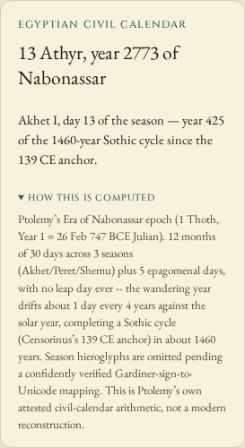
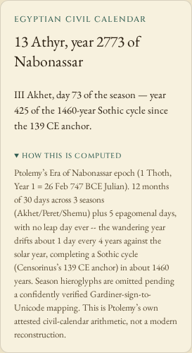

# Put the verified calendar behavior on the public clock

The public clock still used older calculations and explanations than the current
source. Fresh offline browser sessions reproduced the differences below on
Chromium and Firefox at 1440 and 375 pixels. The current source was then checked
from a clean archive before preparing its publication.

| Clock view | Public baseline | Current source |
| --- | --- | --- |
| Egyptian Athyr 13 | Akhet I, season day 13 | III Akhet, season day 73 |
| Ethiopian 2 Tikimt 2019 | Anno Mundi; wrong Coptic epoch explanation | Era of Incarnation, Amete Mihret; Coptic epoch 276 Julian years later |
| Maya `13.0.0.0.0` | No night-cycle label; unsupported alternative in explanation | G9 with the cited cycle rule |
| Interpreted Piedras Negras date `9.12.2.0.16` | No night-cycle label | G7 |
| 25 January 2020, modeled noon at Babylon | 2 Shabatu | 1 Shabatu |
| 26 September 2022, modeled noon at Athens | 1 Pyanepsion | 2 Pyanepsion |
| Chinese lunar year 2033 | No inspectable month ledger/download | Leap-month evidence, keyboard jumps, next-day navigation and JSON snapshot |

[Actual public baseline sessions](results/browser-before.json) and
[current-source sessions](results/browser-local.json) retain complete displayed
labels and explanations. Each phase has four disconnected browser sessions and
24 calendar views. The lunar-year inspector is exercised separately after the
six date views; its actual downloaded JSON must match the installed library.

Before and after on the actual clock:




The [Ethiopian phone view before](../../docs/assets/live-clock/before-firefox-375-ethiopian.png)
and [after](../../docs/assets/live-clock/after-firefox-375-ethiopian.png) retain the
era/explanation correction. The modeled Babylonian day changes
[from 2](../../docs/assets/live-clock/before-chromium-375-babylonian-2020.png)
[to 1](../../docs/assets/live-clock/after-chromium-375-babylonian-2020.png).
The [Maya G7 view](../../docs/assets/live-clock/after-firefox-1440-piedras-negras.png)
and [Chinese-year phone inspector](../../docs/assets/live-clock/after-firefox-375-chinese.png)
show the additional source behavior. These eight retained screenshots were opened
and inspected individually.

## Fresh reference checks

The [UCL month table](https://www.ucl.ac.uk/museums-static/digitalegypt/chronology/calendar.html)
gives four numbered months within each Egyptian season. Only those month
coordinates are used here; its Coptic/Julian dates and leap rule are not applied
to the wandering Nabonassar calculation.

Mark Pitts's [Maya calendar reference](https://www.famsi.org/research/pitts/MayaGlyphsBook2.pdf)
was downloaded afresh and its SHA-256 matched
`1d26c8f3a54ef390e98e35d3585e1f20190c56b4af50881ffb333935714334a3`.
Printed pages 88, 92 and 99 were visually inspected: period endings use G9,
the interpreted inscription uses G7, and the dated January 2004 table agrees.
These check a numerical cycle and cited interpretation, not identities of gods
or a universal historical day-boundary convention. The existing coordinate
replay passes all 442 cases through the freshly built library.

The [Ethiopian church's calendar account](https://www.ethiopianorthodox.org/english/calendar.html)
distinguishes Incarnation and world eras; its 7-8-year comparison concerns
western and Ethiopian chronologies. The current library also agrees with native
ICU Ethiopic/Amete Alem conversions at all 26 fixed dates in the existing era
replay, including explicit handling of proleptic years. That checks date
arithmetic and era representation, not religious observance.

A fresh download of the primary
[JPL DE440s kernel](https://naif.jpl.nasa.gov/pub/naif/generic_kernels/spk/planets/de440s.bsp)
was hash-verified. [conjunctions.py](conjunctions.py) independently finds the two
modern apparent geocentric conjunctions with Skyfield 1.54 and converts them to
past UTC before applying this project's fixed-longitude mean-midnight rule:

| Event | Independent UTC conjunction | Required modeled month day at the selected clock input |
| --- | --- | ---: |
| January 2020 | 24 Jan, 21:41:59.703 UTC | 1 at Babylon |
| September 2022 | 25 Sep, 21:54:34.203 UTC | 2 at Athens |

[Fresh oracle receipt](results/conjunctions.json). These are checks of the
project's stated modern reconstruction. They do not validate ancient crescent
sightings, historical month names or sunset boundaries. The approximate clock
functions retain their documented time-scale/equinox limitations.

The [actual installed-consumer comparison](results/consumer.json) also retains
UTC event errors for these two cases: the registry package is 55.41 minutes early
and 41.88 minutes late; the pinned source is 0.60 and 0.66 minutes late. This is
a two-event comparison, not a general accuracy bound. The separate
[lunar-series study](../lunar-series/README.md) documents its wider grids and limits.

The primary [HKO 2033 table](https://www.hko.gov.hk/en/gts/time/calendar/text/files/T2033e.txt)
was also fetched afresh and matches the existing pinned hash. It starts month 11
on both 22 November and 22 December; 23 December is day 2. The inspector's leap
month 11 row, keyboard jump and following day agree with these dates.
[Selected source rows and digest](results/hko-2033.json). The broader HKO study
and its historical disagreements remain [separately documented](../chinese-calendar/README.md).

## Reproduction and publication boundaries

The clean runtime is source `48adbe3a063a13c16474515370bbbcfc79b8b3f1`.
With its library built, run the browser study against either a local production
preview or the public demo:

```sh
node studies/live-clock/browser.mjs http://127.0.0.1:4202/horologium/ /tmp/clock-browser after dist/lib/index.js
```

The helper loads all bundled fonts before disconnecting, changes real time links,
opens explanations, downloads lunar evidence and exercises keyboard month jumps.
It checks errors, post-disconnection requests, accessibility and horizontal fit.
The `before` mode records the observed older public behavior. Source and hosted
verification are kept separate; no registry release follows from either.

To regenerate the independent conjunctions, install the pinned Python packages
in an isolated environment and supply the verified local kernel:

```sh
python3 -m venv /tmp/horologium-oracle
/tmp/horologium-oracle/bin/pip install skyfield==1.54 numpy==2.4.4
/tmp/horologium-oracle/bin/python studies/live-clock/conjunctions.py /path/to/de440s.bsp /tmp/conjunctions.json
```

## Installed library compatibility

A fresh registry install of **npm 0.2.3** returns G1 from its public night-cycle
function at the Maya period ending, has no `inspectChineseYear`, and accepts
Gregorian `2025-02-29` as another date. The current public Git installation
returns G9, exposes the inspector and refuses that impossible date with
`RangeError`. No new registry version is claimed.

The README's registry quickstart now uses stable Long Count and Hebrew fields
that were checked through both installations. Its corrected-library command
pins the verified public source commit. All **40 shipped JavaScript/declaration
files** match the clean build. The full public entry-point comparison can be
repeated with [consumer.mjs](consumer.mjs):

```sh
node studies/live-clock/consumer.mjs /path/to/registry-package /path/to/source-package /tmp/conjunctions.json /tmp/consumer.json
```

The existing forward-date replay also passes 16,884 valid outputs, 2,623 invalid
refusals/recoveries, and 984 native ICU comparisons. It checks the installed/source
input contract; a hosted static page does not publish the library package.

## Public deployment verified

The reviewed runtime `48adbe3a063a13c16474515370bbbcfc79b8b3f1` and new
source/evidence commit `624e703` are now published. The live Pages deployment is
`55563e1f4ee560b482fb449c25526480231024c9`: all **30 canonical files** match the
tested archive, including the index, app bundle and bundled fonts.
[Served-file hashes](results/hosted-bytes.json).

The [actual public browser replay](results/browser-public.json) repeats all
24 date views and four inspector/download workflows after disconnecting. It
confirms the six corrected labels/dates, actual 2033 lunar-year JSON snapshots,
keyboard month jumps and the next day, with no page errors, post-disconnection
requests, external requests, accessibility violations or page overflow.
[Selected public image comparisons](results/public-images.json) retain their
relationship to the locally inspected screenshots.

No npm version or release tag was created. The README now keeps the purpose and
setup ahead of this detailed correction history, and its registry example was
checked against both the older package and pinned corrected Git installation.
