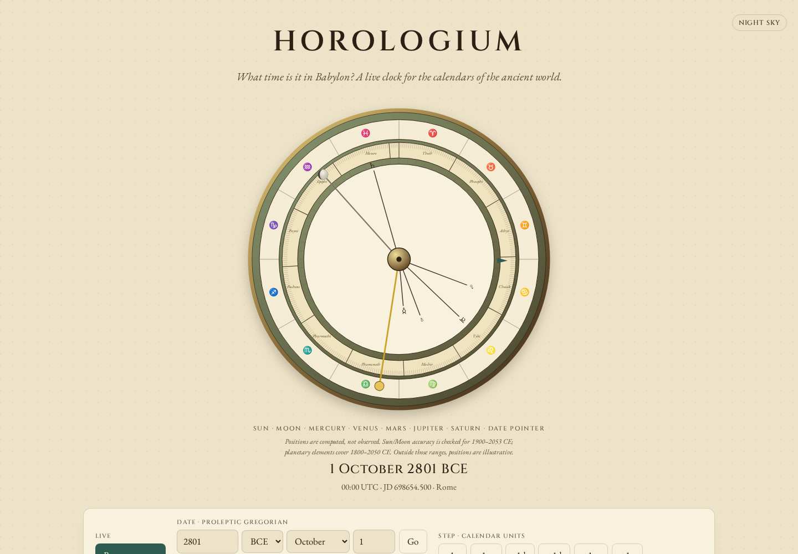
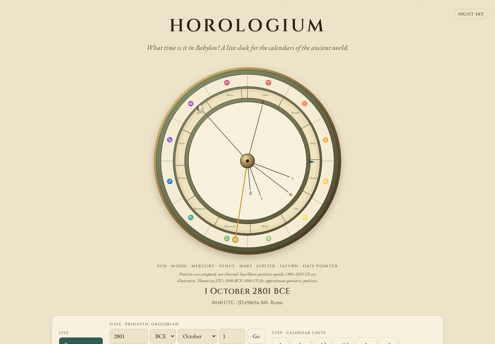
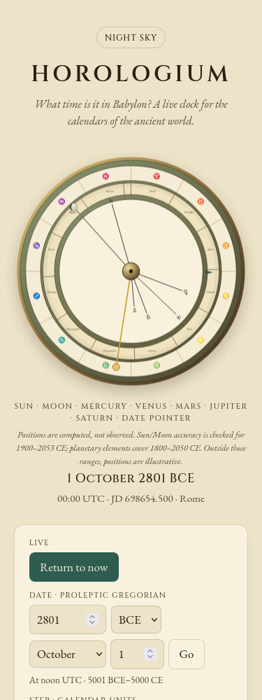

# Planet fits for the ancient dial

The original dial extrapolated JPL's 1800–2050 CE element fit over its full
5001 BCE–5000 CE clock range, and explicitly called ancient positions
illustrative. JPL also supplies a 3000 BCE–3000 CE fit. The current source
uses that published long fit outside the modern interval, with the mandatory
Jupiter/Saturn mean-anomaly terms and the matching Earth-Moon-barycenter
coefficients. The existing modern calculation stays unchanged.

This adds a useful model for the ancient dates the product invites people to
inspect. It does not reconstruct what an ancient observer saw or improve the
Sun/Moon, calendar conjunctions, historical Earth rotation or seasonal hours.

## Independent comparison

The [source manifest](sources.json) retains 30 NASA/JPL Horizons queries, their
complete parameters, URLs, raw-response byte counts and SHA-256 hashes. The
[compressed original responses](raw/) include the provider's headers and CSV
vectors. All identify **DE441**, geometric simultaneous positions, Earth
center (399), ICRF, AU, and JDTDB. Targets 1, 2, 4, 5 and 6 are planetary-system
barycenters, not satellite-kernel-dependent planet centers. Those distinctions
are below this approximate model's precision; they are not silently equated.

[oracle.py](oracle.py) verifies the original response hashes and rotates the
ICRF vectors into the IAU 2006 mean ecliptic/equinox of date using compiled
ERFA 2.0.1.5 (NumPy 2.4.4). It imports no product code. The [grid](grid.json)
contains 273 JDTDB coordinates: four seasons every century, extra dates at
coverage boundaries and around year zero, plus J2000. [grid.py](grid.py)
recreates those coordinates using independent proleptic Gregorian arithmetic.
Horizons' returned mixed-calendar strings are not used as Gregorian dates.

The [before/after replay](results/replay.json) compares all 1,365 positions.
The table below uses the **256 dates inside the long fit and outside the
modern fit**, not extrapolated dates or a dense sweep of every instant.
Angles are geometric geocentric longitudes, in degrees.

| Planet | Before max | After max | Before RMS | After RMS |
| --- | ---: | ---: | ---: | ---: |
| Mercury | 0.09376 | 0.01649 | 0.02281 | 0.00473 |
| Venus | 0.39512 | 0.05890 | 0.05045 | 0.00909 |
| Mars | 0.67319 | 0.10077 | 0.10301 | 0.01758 |
| Jupiter | 11.19512 | 0.25039 | 4.44207 | 0.07922 |
| Saturn | 30.47651 | 0.38333 | 11.10631 | 0.16006 |

Jupiter's zodiac-sector disagreements fall from 23 to zero; Saturn's fall
from 99 to two. Close to a sector boundary, a remaining subdegree error can
still put a pointer on the other side. JPL's published nominal errors are
**heliocentric** and cannot be substituted for these geocentric measurements.

The coefficient tables were extracted from the [JPL source](https://ssd.jpl.nasa.gov/planets/approx_pos.html),
whose downloaded HTML hash is in the manifest. [extract.py](extract.py)
reproduces the numeric-only [coefficients](coefficients.json). An independent
NumPy implementation of the source's orbital equations agrees with the
selected product fit within 3.85e-11 degrees when transformed in the same
frame. The product's existing truncated P03 rotation differs from ERFA by
up to 0.00085 degrees on this long grid; the reported Horizons errors include
that remaining frame approximation.

Omitting Table 2b while retaining Table 2a raises Jupiter's sampled maximum
error to 0.91 degrees and Saturn's to 1.70 degrees. The additional terms are
required parts of the fit, not an optional cosmetic refinement.

The same production page at **1 October 2801 BCE** (proleptic Gregorian,
JD 698654.5) moves Saturn from 344.17 to 15.02 degrees; the independent
reference is 14.65 degrees. This is the largest baseline Saturn error in the
sample. These are unedited browser screenshots, not reconstructed diagrams.

| Before | After |
| --- | --- |
|  |  |
|  |  |

## Coverage, switching and API

`planets.planetPositions(jd)` returns `{ model, positions }`; each position
has `name` and `longitudeDeg`. `planets.planetModel(jd)` provides selection
and coverage without computing positions. `model.inRange` describes only
the fitted element interval, not a precision or observational guarantee.

| Selection | Inclusive JD bounds | Interpretation |
| --- | --- | --- |
| `jpl-1800-2050` | 2378496.5 to 2469807.5 | Table 1, 1800–2050 CE |
| `jpl-3000bce-3000ce` | 625697.5 to 2816787.5 | Tables 2a/2b, 3000 BCE–3000 CE |
| Outside both | Long fit extrapolated, `inRange: false` | Illustrative pointers |

Endpoints are January 1 midnight in the proleptic Gregorian calendar, with
3000 BCE represented by astronomical year -2999. This is a conservative,
explicit endpoint convention for the source's year-labelled intervals.
The modern fit wins where the intervals overlap. The old explicit-element
`PLANETS`/`planetLongitude` helpers retain Table 1 semantics at every date.
The replay verifies all 13,775 positions on the earlier 2,755-date modern
grid are numerically identical, and all 1,365 legacy-helper values are unchanged.

Selecting independently fitted models introduces discontinuities. Sampling
0.000001 day on either side of January 1 gives a largest jump of 0.27243
degrees (Saturn) at 1800 and 0.06511 degrees (Saturn) at 2050. The two fits
are selected directly, without inventing an interpolated third model.
These jumps and the clock's extreme-date extrapolations remain in the receipt.

The input is the nominal JDTDB argument expected by the orbital equations.
The app still passes its civil-clock JD directly. Historical UTC/UT-to-TT/TDB
conversion, light-time, aberration, nutation and topocentric parallax are
omitted. The full ±5000-year clock is not a precision ephemeris.

## Browser and package verification

[Before](results/browser-before.json) and [after](results/browser-after.json)
production builds each pass 56 offline date changes in Chromium and Firefox,
at 1440 and 375 pixels. The actual SVG screen transforms agree with the
selected library longitudes, model notes track the selected interval, and
four accessibility scans per revision report no violations. No page/console
errors, CSP violations, late requests or document overflow were observed.
The [paired replay](results/browser-comparison.json) retains unchanged
Sun/Moon pointers, date readouts and calendar summaries at all 56 cases.
Both screenshot pairs were opened and visually reviewed.

The [clean receipt](results/verification.json) covers implementation `52e75dc`:
Node 24.21.0 / npm 11.19.0, a fresh `npm ci` (zero vulnerabilities), lint,
strict types, 271 unit checks, 58 browser workflows and the documented examples.
The default parallel run hit two five-second test timeouts under the shared
host's load. The full single-worker invocation passed; no test deadlines or
product behavior were edited to obtain that result. Raw [check logs](results/checks/)
retain both runs.

All 361 archived source files remained unchanged, and all 90 generated files
match the Node 26 working build. The clean browser replay repeats 56 offline
date changes and four accessibility scans with no violations, external/late
requests or errors. Its complete page states and both screenshot bytes match
the reviewed local build.

The clean `npm pack` artifact was installed in a fresh consumer project.
Public package imports and strict NodeNext declarations work; Node 20.0.0 and
24.21.0 reproduce the documented planetary and calendar examples. The
[installed replay](results/installed-replay.json) repeats all 1,365 position
comparisons and the 13,775 unchanged modern controls. Registry npm 0.2.3 is
unchanged and predates this namespace.

The [original public site](results/hosted-before.json) matched all 30 baseline
build files and its canonical root before source publication. Corrected public
deployment now [matches all 30 tested files and the canonical root](results/hosted-after.json).
Pages `f6f9669` retains both previous hashed assets for cached pages. Public
source `151c95a` and the deployed build were verified separately; no GitHub
Actions run was available for this publication.

The [canonical live browser replay](results/hosted-browser.json) repeats all
56 offline date changes, with zero page/console errors, policy violations,
external/late requests, document overflow or accessibility violations. All
recorded page states and fetched bytes match the clean replay. Both live
screenshots are byte-identical to the reviewed local images; the
[paired comparison](results/hosted-comparison.json) records their hashes.

A [fresh pinned public Git installation](results/git-install.json) resolves
implementation `52e75dc6cda1c8321c6f7e44d87e717bf1ad9bb0`; all 44 installed
files match the tested packed package. The complete installed replay is also
[identical on Node 20 and 24](results/installed-node-compatibility.json).
A [fresh npm 0.2.3 consumer](results/registry.json) verifies the registry
quickstart still works and that neither the planetary namespace nor the
Chinese inspector is present there. No registry version was published.
The documented development server was also exercised in a real browser;
its [receipt](results/dev.json) retains the ancient Saturn pointer and model note. The source implementation, installed package, hosted bytes and
browser behavior are separate surfaces; no npm release is implied.

## Reproduce

With the baseline (`73068bc`) and candidate built:

```sh
python3 studies/long-range-planets/grid.py /tmp/grid.json
# In a Python environment with numpy==2.4.4 and pyerfa==2.0.1.5:
python studies/long-range-planets/oracle.py /tmp/oracle.json
node studies/long-range-planets/replay.mjs /path/to/baseline . /tmp/replay.json
node studies/long-range-planets/browser.mjs . /tmp/browser.json /tmp/screenshots
npm run build:lib && node examples/planet-positions.mjs
```

The browser command can target a public deployment with
`HOROLOGIUM_STUDY_URL=https://antonsoo.github.io/horologium/`. Every fetched
body must match the supplied build. After startup it disconnects the tab
and shuts down its local server before navigating dates.
