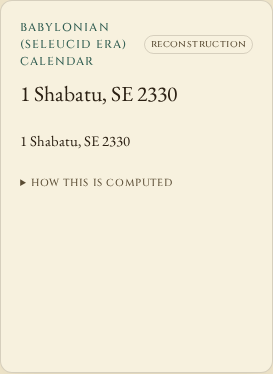
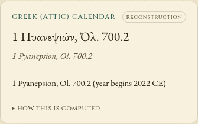

# Correcting the lunar longitude series

Baseline: `a2ce92063118165d009612512ecbb6109fdd4b63`. This is source work,
not a package release or a hosted deployment.

The old ten-term Moon formula was not simply a coarse truncation. It reversed
the signs of the `2M'` and `2D-M-M'` terms, omitted major `M` and `2F` terms,
used other incorrect angular arguments, and had the wrong quadratic coefficient
for the Moon's mean anomaly. For example:

| Argument | Old amplitude, degrees | Correct amplitude, degrees |
| --- | ---: | ---: |
| `2M'` | -0.214 | +0.213618 |
| `M` | absent | -0.185116, scaled by E |
| `2F` | absent | -0.114332 |
| `2D-M-M'` | -0.0573 | +0.057066, scaled by E |

`moon-longitude.ts` now contains all 59 nonzero longitude terms of Meeus
chapter 47, the complete mean-argument polynomials, eccentricity factors and
three additive corrections. The distance-only sixtieth row is omitted.
The longitude portion is adapted from the MIT-licensed
[astronomia implementation](https://github.com/commenthol/astronomia/blob/71e16c942b143a1a5a067b6aab2d8532064704ae/src/moonposition.js),
with attribution in `THIRD_PARTY_NOTICES.md`. No runtime dependency is added.

## Independent numerical evidence

`oracle.py` uses Skyfield 1.54, NumPy 2.4.4, compiled ERFA 2.0.1.5 and the
hash-pinned JPL DE440s kernel. It does not import Horologium or astronomia.
The position grid samples every seventh day from 1900 through 2100 and every
day of 2026: **10,801 distinct instants**. Geometric Moon-minus-Earth vectors
are rotated into the mean ecliptic/equinox of date by ERFA. A separate Skyfield
calculation supplies apparent positions and all **2,487 conjunctions** in the
same interval.

| Measurement on the retained grids | Before | Corrected |
| --- | ---: | ---: |
| Maximum mean-equinox longitude error, same nominal TT | 0.965756 degrees | 0.003846 degrees |
| Maximum conjunction-time error, same nominal TT | 85.090447 minutes | 1.650819 minutes |
| Maximum apparent-longitude error for 365 actual UTC inputs in 2026 | 0.802998 degrees | 0.016719 degrees |
| Maximum error for 14 selected modern UTC conjunctions | 82.866273 minutes | 2.365332 minutes |

The time scales are intentionally separate. The existing illustrative API
uses its supplied Julian day directly as its dynamical argument. It still
does not convert UT/UTC to TT, and Moon longitude remains relative to the
mean equinox without nutation. Its illuminated fraction uses ecliptic
elongation and does not model lunar latitude. The actual-UTC comparison
retains those errors instead of presenting the smaller equal-TT error as
clock accuracy. Future UTC examples use Skyfield's bundled leap-second table;
future leap seconds are not predicted.

For the 2,487 nominal-TT conjunctions, assigning the project's mean-midnight
day differs from the independent event day **62 -> 1** times at Babylon's
longitude and **41 -> 1** times at Athens'. The remaining differences are
retained in `results.json`. This is not validation of ancient observed dates,
crescent sightings or historical month names. Far-ancient/future orbital
accuracy is unverified; the clock's existing illustrative labels remain.

The implementation also agrees with the pinned astronomia calculation over
11,202 inputs, including 401 computational probes from year -5000 through
5000, within `1.26e-8` degree. That is a transcription check, not independent
astronomical validation. See [implementation.json](implementation.json).

## Changed behavior

At JD `2461147.9663565955`, before the April 2026 conjunction, the old library
reports lunar age `0.0295943` day: it has already reset. The corrected library
reports `29.4067628` days. The independent conjunction is still ahead.

Two visible reconstructed-calendar examples use independent modern UTC
conjunctions, including the leap-second offset, to establish the mean-midnight
day required by this project's own rule:

| Clock input | Old display | Corrected display |
| --- | --- | --- |
| 25 January 2020, mean noon at Babylon | 2 Shabatu, SE 2330 | 1 Shabatu, SE 2330 |
| 26 September 2022, mean noon at Athens | 1 Pyanepsion, Ol. 700.2 | 2 Pyanepsion, Ol. 700.2 |

The reference conjunctions are 24 January 2020 at 21:41:59.703 UTC and
25 September 2022 at 21:54:34.203 UTC. The model's day convention remains
mean midnight at 44.4275 or 23.7275 degrees east, not historical sunset.

| Babylonian view before | After |
| --- | --- |
|  |  |

| Attic phone view before | After |
| --- | --- |
|  |  |

## Keeping repeated calculations inexpensive

The complete series costs more than the malformed short table. Greek and
Babylonian calculations now retain at most eight private year structures,
so live updates and nearby date steps reuse lunations already calculated.
Greek cache intervals are bounded by the calculated solstices; Babylonian
entries are keyed by Seleucid year. Returned date records cannot expose or
mutate cached arrays.

`verify.mjs` executes the original uncached calendar code with imports rebound
to the corrected arithmetic. **1,512 comparisons**, including out-of-order era
jumps, revisits beyond the cache capacity and both sides of month boundaries,
match. Every returned record is then mutated and the call repeated to check
that callers cannot corrupt the cache. **1,680 descriptions from ten other
calendar methods** remain identical to baseline.

First-pass elapsed times from one serial Node 24.21.0 run on 14-vCPU WSL2:

| Input grid, both calendars per input | Old short series | Full series, uncached | Full series, cached |
| --- | ---: | ---: | ---: |
| 120 adjacent second values | 105.49 ms | 295.13 ms | 10.67 ms |
| 365 daily steps | 270.39 ms | 811.11 ms | 2.89 ms |
| 120 adjacent values in the solstice/new-year gap | 129.09 ms | 408.41 ms | 0.06 ms |

Each variant runs in its own process. The three grids run consecutively, so
later grids can reuse years from earlier grids; these are not all cold calls.
`benchmark.json` retains all three passes and output hashes. Cached and uncached
full-series outputs match exactly. These are local calculation timings, not
browser frame-rate measurements or a portable speed guarantee.

## Browser and interval checks

`browser.mjs` serves the actual production build with `Cache-Control: no-store`,
loads the bundled fonts, makes the context offline and stops the server before
changing dates. Six inputs in Chromium and Firefox at 1440 and 375 pixels give
**48 date changes** across baseline and corrected builds. It waits for animations
and checks **336 rendered Sun/Moon/planet directions** using SVG screen matrices,
with 0.0006 degree allowed for CSS serialization. Calendar text matches the
corresponding built library. Across the 24 paired views, all other calendar
text, date readouts and six non-lunar needle directions remain unchanged.
There are no offline HTTP attempts, console/page errors, accessibility
violations or horizontal overflow. All four screenshots were inspected.

The earlier daily-grid interval verifier is also run with the corrected model
in both input slots. It independently checks 5,964 lunar-search cases, 5,035
Babylonian and 5,015 Attic interval assignments, plus a 10,001-year sweep and
10,001 reusable crossings. All agree. The wrapper in `intervals.json` explicitly
labels this as model-consistency validation, not a before/after accuracy gain.

## Clean archive and installed package

A clean archive of production commit
`c0d07d34178bb5d6c2a2fa613fcf85e4cce8901c` passes offline installation,
lint, TypeScript checks, 235 tests in each of two locales, the production build,
the runnable example and 58 existing browser workflows. All 108 selected
source/test/replay inputs and 87 built files (957,405 bytes) match the tested
checkout. All 29 assets served in each corrected browser run match that build.
Fifteen compiled JavaScript modules outside the changed astronomy/calendar
modules remain byte-identical to baseline.

The archive's npm tarball is 74,735 bytes, SHA-256
`7f0ba627e1e33530783dc24a2d3e36683ed93a2c217470d32f4f354e63e173f2`.
All 42 package files match the clean archive and the separate offline install.
The full numerical replay matches under Node 20.0.0 and 24.21.0, with identical
records apart from the runtime version. Installed Maya, Hebrew, Roman, Egyptian
and Chinese README examples reproduce their stated outputs. These checks run
on Linux/WSL2. Package version 0.2.3 is unchanged; no registry release or hosted
deployment is included.

See [artifact hashes](artifacts.json), [Node 20 replay](installed-node20.json),
[Node 24 replay](installed-node24.json) and [installed examples](installed-quickstart.json).

## Reproduce

```sh
python studies/lunar-series/oracle.py /path/to/de440s.bsp /tmp/oracle.json
node studies/lunar-series/verify.mjs /path/to/baseline /path/to/candidate results.json
node studies/lunar-series/compare-implementation.mjs /path/to/pinned/astronomia /path/to/candidate implementation.json
node studies/lunar-series/browser.mjs /path/to/built/candidate browser.json /tmp/screenshots
node studies/lunar-series/benchmark.mjs /path/to/candidate /tmp/benchmark.json
node studies/lunar-series/benchmark.mjs /path/to/candidate /tmp/uncached.json /path/to/baseline
node studies/lunar-boundaries/verify.mjs /path/to/candidate /path/to/candidate /tmp/intervals.json
```

Use baseline `a2ce920` and the source versions pinned in the scripts. The
Python generator requires a local kernel and makes no network requests.
The numerical verifier accepts an installed npm package directory. Browser
replay requires the checkout's Playwright dependencies and browser binaries.

Evidence: [oracle](oracle.json), [results](results.json), [implementation parity](implementation.json),
[timings](benchmark.json), [intervals](intervals.json), [browser before](browser-before.json),
[browser after](browser-after.json).
