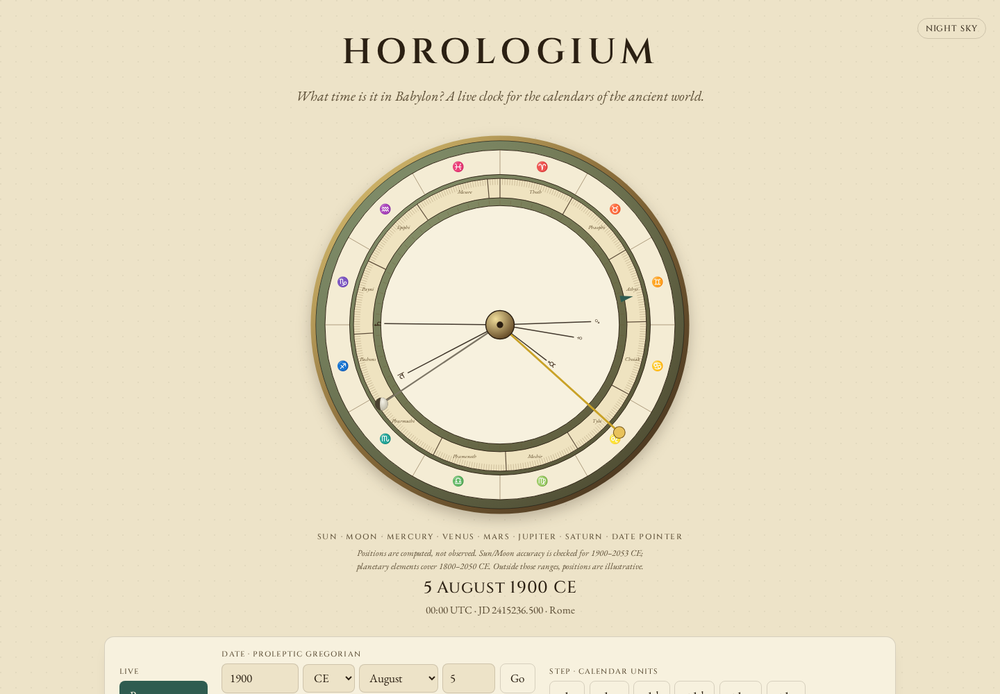

# Planet pointers and the moving equinox

Baseline: `26e8bbdf28e668cf034dd2277eab9b03d93f6e5d`. This corrects source
and the locally built clock; it is not an npm release or a hosted deployment.

The orbital calculation returned longitude in the **J2000 mean ecliptic and
equinox**, then placed it directly on a **tropical zodiac of date**. The mismatch
grows with distance from the year 2000. On 2 January 2026, for example, Mercury
was drawn at 269.825898 degrees, just before Capricorn. The corrected result is
270.189151 degrees; the independent geometric reference is 270.189459 degrees.
This is a coordinate correction, not an interpretation of zodiac signs or a
claim about the IAU constellation boundaries.

## Independent calculation

`oracle.py` does not import Horologium. It reads the local, hash-pinned JPL
DE440s kernel using Skyfield 1.54, computes the simultaneous planet-minus-Earth
vector, and rotates it with compiled ERFA 2.0.1.5 `ecm06` matrices. Mercury and
Venus use their centers; Mars, Jupiter and Saturn use their system barycenters.
It also records apparent longitudes from Skyfield, including light-time and
apparent-place corrections, as a separate comparison.

The grid contains the first day of every month from January 1850 through
January 2050, every day of 2026, and 5 August 1900: **2,755 distinct dates,
13,775 planet positions**. All use the same nominal TT Julian day as the
formula's argument. This isolates frame/orbital errors; it does not verify
UTC-to-TT conversion. DE440s does not cover 1800, so this ephemeris comparison
does not cover the full 1800-2050 validity interval of the fitted elements.

Maximum absolute angular errors in degrees, measured on this grid:

| Planet | Before, mean of date | After, mean of date | After, apparent of date | Mean-sector disagreements, before -> after |
| --- | ---: | ---: | ---: | ---: |
| Mercury | 2.100364 | 0.011864 | 0.025152 | 104 -> 0 |
| Venus | 2.095060 | 0.026843 | 0.025853 | 66 -> 0 |
| Mars | 2.090389 | 0.060638 | 0.062670 | 81 -> 1 |
| Jupiter | 2.134155 | 0.176074 | 0.168821 | 73 -> 4 |
| Saturn | 2.276355 | 0.230135 | 0.229291 | 81 -> 7 |

The **12 remaining sector disagreements** are retained, not treated as a clean
astronomical result. Approximation error still crosses some 30-degree sector
boundaries. The independent apparent comparison is also not identical to the
geometric comparison; `results.json` keeps both sets of counts and errors.

The original calculation compared much more closely with the reference in
J2000 (per-planet maxima 0.011864-0.230132 degrees). That isolates the omitted
frame rotation from the residual orbital-model error.

## Correction and limits

`precession.ts` rotates the **complete three-dimensional geocentric vector**
through the J2000 mean equator, precesses it to the mean equator of date, then
rotates into the mean ecliptic of date. Only then is longitude calculated.
Dropping the vertical component before rotating would discard the ecliptic
pole's motion and affect inclined orbits. The P03 angles and obliquity follow
[Capitaine, Wallace and Chapront (2003), equations 39-40](https://syrte.obspm.fr/iau2006/aa03_412_P03.pdf).

An independent set of **588 fixed-vector rotations** spans 1800, 1850, 1900,
1950, 2000, 2026 and 2050; 12 longitudes; and seven latitudes from -80 through
+80 degrees. Against ERFA's matrix product, the largest unit-vector component
difference is `3.32e-12`. Distances are preserved. The five planet positions at
J2000 remain unchanged within `1e-12` degree.

The [JPL elements](https://ssd.jpl.nasa.gov/planets/approx_pos.html) and their
two-body propagation are unchanged. The Earth approximation still uses the
Earth-Moon barycenter. No light-time, aberration or nutation correction is added,
and the clock still uses its supplied Julian day directly as the dynamical
argument. The results are geometric mean directions, not full apparent places.
Ancient/far-future positions remain illustrative. No new dependency is added.
Every other compiled library module, including all calendars and Sun/Moon
calculations, is byte-identical to baseline (`results.json` records their hashes).

## Actual browser replay

`browser.mjs` loads production assets with `Cache-Control: no-store`, waits for
all bundled fonts, makes the context offline, and stops the server **before**
changing dates. Chromium and Firefox each run at 1440 and 375 pixels. Nine dates
include five 2026 examples, the 1900 Saturn example, J2000, and both ends of the
clock's supported year range. Ancient endpoints check finite rendering only.

The replay waits for real animations to finish and measures needle endpoints
through their rendered SVG screen matrices. All five needles agree with the
corresponding built calculation within 0.0006 degree, allowing CSSOM's decimal
serialization. The baseline and corrected replays cover **72 date changes,
360 rendered planet directions**. Across the 36 paired views, calendar text,
Sun/Moon target directions, date readouts and limitation labels are unchanged.
There are no offline HTTP attempts, page errors, console errors, accessibility
violations or horizontal overflow in these checks. Receipts retain all 29 served
asset hashes for each browser session.

The screenshots show the settled clock at 5 August 1900. Saturn's leftward
needle crosses the Sagittarius/Capricorn boundary; the small movement is
measured numerically in the receipts.




Phone views: [before](../../docs/assets/planet-frame-before-phone.png),
[after](../../docs/assets/planet-frame-after-phone.png).

## Reproduce

From this checkout, after building the baseline and candidate:

```sh
python studies/planet-frame/oracle.py /path/to/de440s.bsp /tmp/oracle.json
node studies/planet-frame/verify.mjs /path/to/baseline /path/to/candidate results.json
node studies/planet-frame/browser.mjs /path/to/built/candidate browser.json /tmp/screenshots
```

The first command requires the exact Python versions in `oracle.py` and the
kernel whose URL/hash is in `oracle.json`. It makes no network requests. The
second command uses the committed fixture and accepts an installed npm package
directory as its candidate. The browser command requires the checkout's
Playwright dependencies and installed Chromium/Firefox binaries.

Machine-readable evidence: [reference](oracle.json), [comparison](results.json),
[browser before](browser-before.json), [browser after](browser-after.json).

## Clean and installed artifacts

A clean archive of production commit
`56c4384004582f4d8f4feba3bb5d491f5ec7a9d2`, installed offline under Node
24.21.0, passes lint, both TypeScript checks, 229 tests in each of the default
and comma-decimal locales, the production build and all 58 existing browser
workflows. The documented library example runs from that archive and from a
separate package installation; the README's Maya, Hebrew and Roman examples
also reproduce their stated results.

The packed 0.2.3 artifact is **73,248 bytes**, SHA-256
`05f9385def112be69f26716560b8d529b2621c0452300aacf8d5b231b118082e`.
All 40 package files match both the clean build and separate offline npm
installation. The full ephemeris/rotation replay under installed Node 20.0.0
and 24.21.0 yields the same records as the working and clean builds, apart
from the recorded Node version. All 103 selected source/test/replay inputs
and all 84 build files (951,937 bytes) match the exercised checkout. The 29
served browser assets match the clean build byte-for-byte.

A fresh download from JPL is byte-identical to the 32,726,016-byte kernel used
for the oracle, SHA-256
`c1c7feeab882263fc493a9d5a5b2ddd71b54826cdf65d8d17a76126b260a49f2`.
Validation runs on Linux/WSL2; this is not physical observation or a guarantee
of planetary accuracy outside the sampled dates.

Receipts: [artifacts](artifacts.json), [installed Node 20](installed-node20.json),
[installed Node 24](installed-node24.json), [README examples](installed-quickstart.json).
