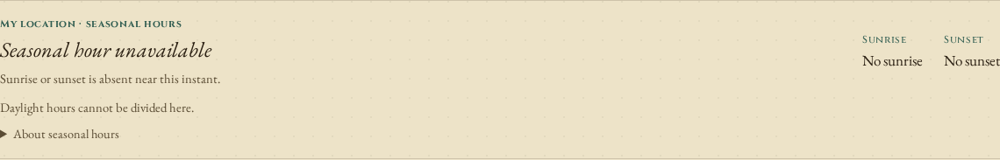
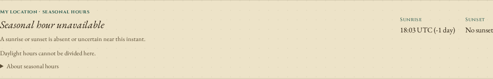
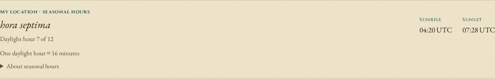
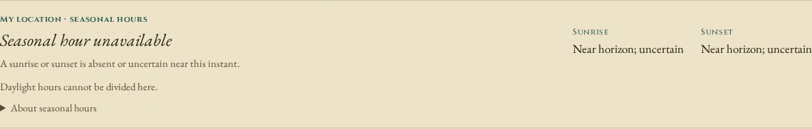

# Solar crossings and polar-season transitions

Horologium's original sunrise calculation evaluated the Sun at UTC noon, then
used that one declination for both events. Near a polar-season transition, the
Sun changes enough during the day that the frozen geometry can invent a crossing,
miss a real one, or put a boundary more than two hours away from its ephemeris
counterpart. The clock also discarded both boundaries whenever either was absent.

The corrected source searches for the actual crossings of its changing solar
model. It retains sunrise and sunset independently and withholds grazing
boundaries that this approximate model cannot establish reliably. This is a
numerical model study, not a record of observed sunrise or weather.

## What changed in the clock

At 70 S, 90 E, the solar day labelled 2026-11-18 has a modeled sunrise on the
previous UTC date and no following sunset in that solar cycle. The original
clock displayed **No sunrise / No sunset**. The corrected clock retains
**18:03 UTC (-1 day) / No sunset**. Its seasonal hour remains unavailable,
since there is no bounded daylight interval to divide into twelve parts.

Original production output:



Corrected production output:



A second control at 89 S, 90 E on 2026-09-18 originally claimed daylight from
04:20 to 07:28 UTC and displayed **hora septima**. The JPL comparison finds no
crossings in that interval. The corrected low-precision model's daily maximum
is close enough to the horizon that the clock withholds both boundaries as
**Near horizon; uncertain** and does not assign a seasonal hour.





These are app screenshots with labelled synthetic geolocation controls, using
real browser rendering and calculations. The coordinates are test inputs, not
a claim about a user's location. Four offline Chromium/Firefox visits at 1440
and 375 pixels exercise sixteen controls per source build. The original and
corrected [browser receipts](after/browser.json) retain exact input instants,
visible output, privacy-preserving hashes and runtime checks.

## Independent producer and comparison

`capture.py` uses Skyfield 1.55 and JPL DE421. It calls `find_risings` and
`find_settings` for the apparent topocentric solar center at -0.8333 degrees,
matching the application model's nominal refraction/semidiameter convention.
Skyfield returns a transit placeholder plus `False` when a crossing does not
exist; the capture explicitly discards those placeholders. Every retained
reference is an actual crossing of the ephemeris model.

The script uses a latitude/longitude grid (14 latitudes from 89 S to 89 N,
five longitudes) plus Rome, Babylon, Tromso and Utqiagvik: 74 site-years in 2026.
The grid includes ordinary locations, the polar circles and both sides of the
date line. JPL bytes are SHA-256 pinned in the fixture and replay provenance.
No ephemeris or Skyfield code is bundled into the app.

Primary references:

- [Skyfield almanac documentation](https://rhodesmill.org/skyfield/almanac.html):
  topocentric observers, event definitions and polar fallback flags.
- [JPL DE421 ephemeris](https://ssd.jpl.nasa.gov/ftp/eph/planets/bsp/de421.bsp):
  the independent position source, downloaded only by the development script.
- [NOAA calculation details](https://gml.noaa.gov/grad/solcalc/calcdetails.html):
  the limitations of approximate solar times and atmospheric conditions.

The replay calls each library on 367 dates, including padding at the year
edges so longitude cannot lose an event at New Year. It collects distinct
modeled crossings in the UTC-like 2026 interval and matches each to an unused
same-direction ephemeris event within half a day. The large matching window
retains the original multi-hour errors rather than dropping them as unmatched.
Events without a counterpart and counterparts without a model event stay
visible in the results.

| 2026 ephemeris comparison | Original | Corrected |
| --- | ---: | ---: |
| Reference crossings | 37,247 | 37,247 |
| Timestamped and paired crossings | 37,172 | 37,148 |
| Reference crossings withheld as grazing | 0 | 99 |
| Unmarked missing reference events | 75 | 0 |
| Timestamped events without a counterpart | 90 | 0 |
| Paired time errors over five minutes | 1,495 | 0 |
| Largest paired time error | 133.135 min | 2.113 min |

The corrected output timestamps 99.73% of the reference crossings in this
sample and explicitly withholds the remaining 99. It also marks uncertain
cycle boundaries where the ephemeris has no crossing; the nominal band does
not assume that a grazing event really happened. Twelve accepted crossing
errors exceed one minute, retained in the per-site results. These sampled
errors are not a universal guarantee.

The [original](before/replay.json) and [corrected](after/replay.json) results
retain each site's unmatched/withheld events and two largest errors. Grazing
reference assignment allows one minute at a modeled cycle edge, matching the
clock's displayed resolution: the ephemeris minimum can fall seconds beyond
the low-precision model's minimum. The matching tolerance is recorded in the
receipt. Eleven reference cases are committed in
`tests/fixtures/solar-events.json`; the much larger working data is ignored.

## Model and uncertainty

The solver refines meridian transit, searches for the neighboring daily
altitude extrema and bisects each existing horizon crossing. Declination and
equation of time are evaluated at each candidate instant. Optimizing extrema
matters near the poles: the altitude maximum need not coincide with meridian
transit while declination is changing. Leading-order solar parallax is included
at 1 AU; its annual variation is below this model's angular precision.

The existing Sun-coordinate test uses a 0.02-degree ceiling. The event search
uses the same nominal angular band around each daily extremum as an uncertainty
guard. If a maximum or minimum falls inside that band, the affected boundary's
timestamp is withheld and its status is `grazing`. This is an engineering guard,
not a probability interval or a bound on weather or ancient-date errors.

The public source API is `astronomy.solarDayEvents(jd, latitude, longitude)`:

| Status | Timestamp | Meaning |
| --- | --- | --- |
| `crossing` | Julian Day | A crossing is supported by this model outside the grazing guard |
| `absent` | `null` | This modeled solar cycle has no such crossing |
| `grazing` | `null` | The model cannot reliably establish that boundary near an extremum |

The `sunTimes` compatibility wrapper retains its previous numeric shape,
transit placeholders and `circumpolar` flag. Prefer the new API for event
semantics. The clock and Roman-hour calculation use nullable boundaries;
a placeholder can no longer become a displayed measured hour.

No Delta-T, elevation, terrain or variable atmospheric refraction correction
was added. UTC approximates UT1 in the clock. The fixed low-precision solar
series is still illustrative at ancient epochs. The 2026 grid does not extend
its historical accuracy, and the sampled maximum latitude is 89 degrees.

## Clean source and installed package

The [clean verification](../../docs/verification-solar-events-2026-10-19.md)
covers a fresh Node 24 install, numerical and production-browser checks,
byte-identical library/site builds, and a separate packed consumer replay.

## Reproduce

From this checkout, with Node 24+ and Python/uv:

```sh
npm ci && npm run build
uv run --with skyfield==1.55 python studies/solar-events/capture.py
node studies/solar-events/replay.mjs studies/solar-events/after
```

To replay the original implementation, extract and build source `c8c9d2b`,
then pass its `dist/lib/index.js` as the replay command's second argument.
The replay records elapsed time including comparison work; those numbers
are not a solver-only performance benchmark.

Serve the built `dist/app/` through Vite preview, then run:

```sh
node studies/solar-events/browser.mjs http://localhost:4256/horologium/ OUTPUT_DIR after
```

Use `before` against the original build to assert its incorrect output.
No fresh audio, ephemeris or other requests are needed by the loaded app.
The study captures a desktop panel and a phone-width full workflow; every
retained screenshot was inspected. The visual identity, dial and layout remain
those of the existing clock; the new states use its current typography and
spacing. Local/source, installed-package and deployment results are recorded
separately when verified. npm 0.2.3 predates this source API.

## Publication

Source `520813a` and Pages `2197d44` were pushed after clean and installed-package
verification. Pages appends to the previous branch history; old hashed assets
remain available to cached pages. All 30 current static files matched the live
site by SHA-256 ([receipt](hosted-bytes.json)). All 62 production browser
workflows and the sixteen dedicated offline controls passed on that deployment
([study receipt](hosted-browser.json)).

A fresh public Git consumer resolved the pinned implementation revision and
reproduced the complete reference replay. The README's pinned Git install now
selects that implementation. [Publication receipt](publication.json). No npm
registry version or tag was published.
